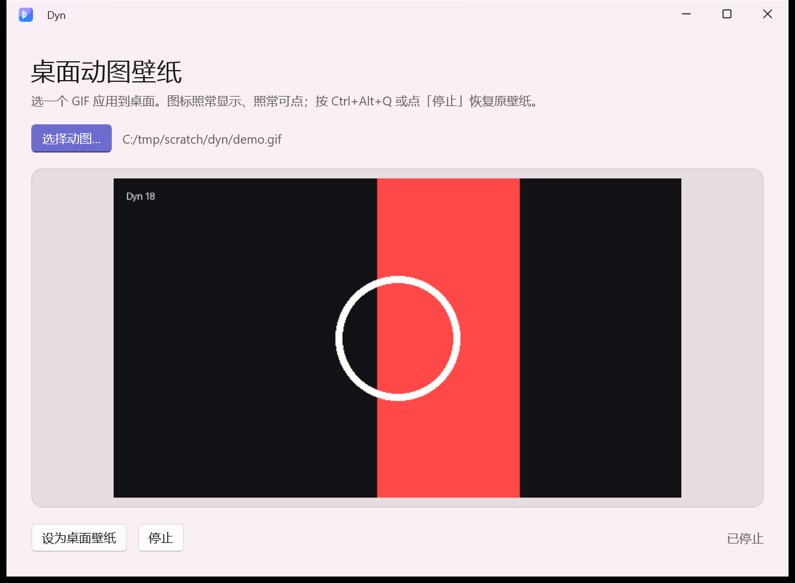
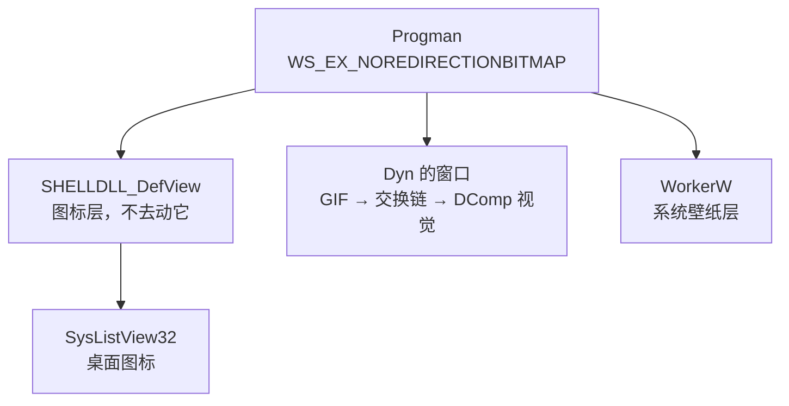

# Dyn

**极简的动态壁纸：把自己的 GIF 放到桌面，图标照常显示、照常可点。**

A minimal live-wallpaper app for Windows 11 — play your own GIF behind the desktop icons.



## 特点

- 用你自己的 GIF，不转码、不裁切
- 图标不被遮住，位置和点击都正常
- Win+D 不消失；不进任务栏、不进 Alt+Tab
- 画面交给 GPU（DirectComposition），播动图约 1.4 s CPU / 25 s
- 引擎是独立命令行程序，可以脚本化启停

## 使用

解压整套后双击 `Dyn.exe` → **选择动图…** → **设为桌面壁纸**。
停止：点「停止」，或按 `Ctrl+Alt+Q`。

引擎也能单独跑：

```bat
Dyn.Engine.exe demo.gif              :: 设为壁纸
Dyn.Engine.exe --quit                :: 恢复原壁纸
Dyn.Engine.exe demo.gif --preview 5  :: 普通窗口预览 5 秒
Dyn.Engine.exe demo.gif --log run.log
```

## 环境

- Windows 11 24H2 或更高（开发验证：26300）
- 运行不需要安装：`Dyn.exe` 同目录的整套文件一起拷走即可（自包含，约 340 MB）
- 自己构建需要 .NET 9 SDK（引擎）和 .NET 10 SDK + Windows App SDK（界面）

## 原理

24H2 之后桌面窗口树是这样：



窗口夹在图标层与壁纸层之间，所以图标永远在上面。两条关键：

1. `Progman` 没有重定向表面，子窗口只能用 **DirectComposition** 上屏。GDI、WPF、`UpdateLayeredWindow`、`SetLayeredWindowAttributes` 都会“调用成功，屏幕上什么都没有”。
2. 壁纸层 `WorkerW` 不存在时，要先给 `Progman` 发 `0x052C` 让它生成，否则 `Progman` 自己的合成层会盖住所有子窗口。

## 构建

```bash
dotnet publish engine/Dyn.Engine.csproj -c Release -r win-x64 --self-contained true -p:PublishSingleFile=true -o engine/publish
dotnet build app/Dyn.csproj -c Release -p:Platform=x64
```

产物在 `app/bin/x64/Release/net10.0-windows10.0.26100.0/win-x64/`，**整个目录**一起分发。

图标可重新生成（改色改形后重跑）：

```bash
python docs/icon/make_icon.py
```

## 验证（2026-11-20，Windows 11 26300，2240×1400 @150%）

| 项 | 结果 |
|---|---|
| 壁纸区像素 | 应用后 (17,18,21)（动图内容），原壁纸 (150,141,155) |
| 图标 | 图标区 22.4% 非背景像素，位置和点击正常 |
| 动画 | 1.1 s 两帧差 7.6 万像素 |
| 开销 | CPU 1.4 s / 25 s，内存 150 MB |
| 退出 | `Ctrl+Alt+Q`、`--quit`、界面「停止」都恢复原壁纸 |

## 已知限制

- 只支持 GIF。视频需要另接解码，交换链和 DComp 那一段可以直接复用
- 多显示器按整块虚拟桌面绘制，画面居中缩放
- 依赖 GPU 的 DirectComposition，老显卡或远程桌面下可能不可用（会提示）

## 许可

MIT
